<h1 align="center">Skybound Realms</h1>
<p align="center"><b>A 3D isometric tower defense on floating islands</b>: build anywhere on the grass, rewire the bridges, fuse your towers and protect the core crystal.</p>

<p align="center">
  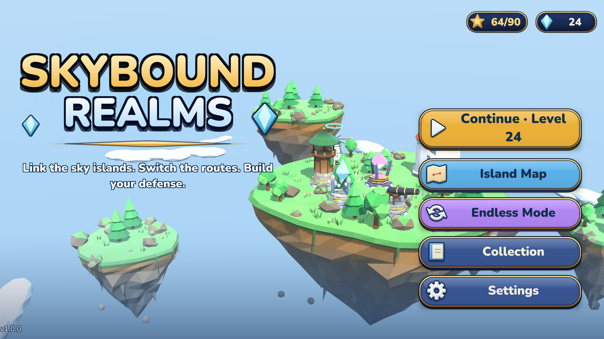
  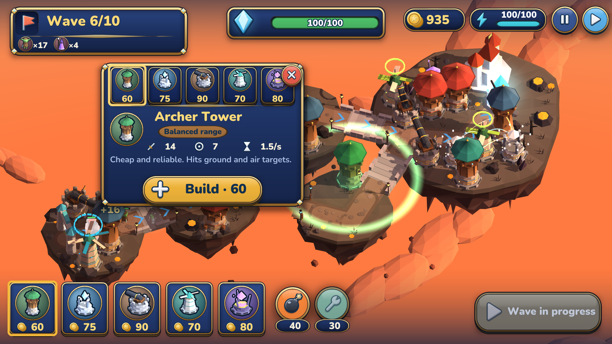
</p>

> **Status:** in development · Android / iOS (landscape) · built with Unity 6.3 LTS

## The game

Enemies march across a chain of floating islands toward your **core crystal**. The real map is the **bridge network** between the islands, and you can put a tower on **any patch of grass**.

* **Build anywhere.** Pick a tower, tap the grass and a ghost shows the spot with its **range ring**. Roads, bridges, island edges and the core are off limits, towers keep their distance from each other, and energy pads still give a bonus.
* **Switch bridges to change the route.** Flip a bridge and the next wave takes another path. Switching costs energy and has a cooldown; enemies finish the bridge they are on and turn at the next junction.
* **Five tower levels.** Levels 2 and 3 are plain upgrades. At **level 4 you pick one of 3 paths**, at **level 5 one of 2 refinements** of that path, which makes **90 permanent upgrade choices**. Every stage has its own model, and range rings grow as a tower levels up.
* **Fuse towers.** From the second act, two **level-3** towers can fuse into a **hybrid** with both powers: Archer + Cannon = Siege Archer, Ice + Wind = Rime Spire, Spark + Crystal = Storm Core, Cannon + Venom = Plague Mortar, Flak + Spark = Tesla Flak.
* **Targeting priority** per tower: first, last, strongest, weakest, closest.
* **Abilities arrive when you need them.** No airship or repair button on level 1; each one is introduced with a short explanation on the level that unlocks it.
* **Endless mode** opens when every tower is unlocked: three maps, ever-growing waves and a boss every ten waves.

### Towers

| Tower | Role |
|---|---|
| **Archer** | Fast, hits air and ground |
| **Frost** | Slows everything it touches |
| **Cannon** | Slow, heavy ground splash that cracks armor |
| **Wind** | Pushes enemies back along the road |
| **Crystal** | No attack: gold, a core shield or a damage aura |
| **Spark** | Chain lightning that mostly ignores armor |
| **Venom** | Poison that ignores armor and stops regeneration |
| **Ballista** | Very long range, armor-piercing heavy bolts |
| **Flak** | Anti-air area bursts that wipe out swarms |
| **Seer Beacon** | Reveals cloaked enemies and marks targets for extra damage |

### Enemies

Fourteen types make you change tactics. The newest ones are built to be countered by specific towers: **Phantoms** are cloaked and can only be shot inside a Seer's range, **Swarmers** are fast flying clouds for Flak, **Ironclads** shrug off arrows until Cannons, Ballistae or poison crack them, and **Sprout Golems** regrow unless Venom stops them. They join Scouts, Armored, Raiders, Mages, Healers, Splitters, Bulwarks, Breakers and the bosses.

### Campaign

* **30 levels in 9 biomes** across two acts, with a safe-or-risky branch after level 5 and again after level 18
* Hazards that change how you play: volcano eruptions, blizzards that slow your towers, droughts that stop your energy, spore blooms that heal enemies, tower limits
* **3 stars per level**, permanent crystal upgrades, English and Turkish, accessibility options

## Screenshots

<table>
  <tr>
    <td align="center"><br><sub>Place a tower on any grass, with its range ring</sub></td>
    <td align="center">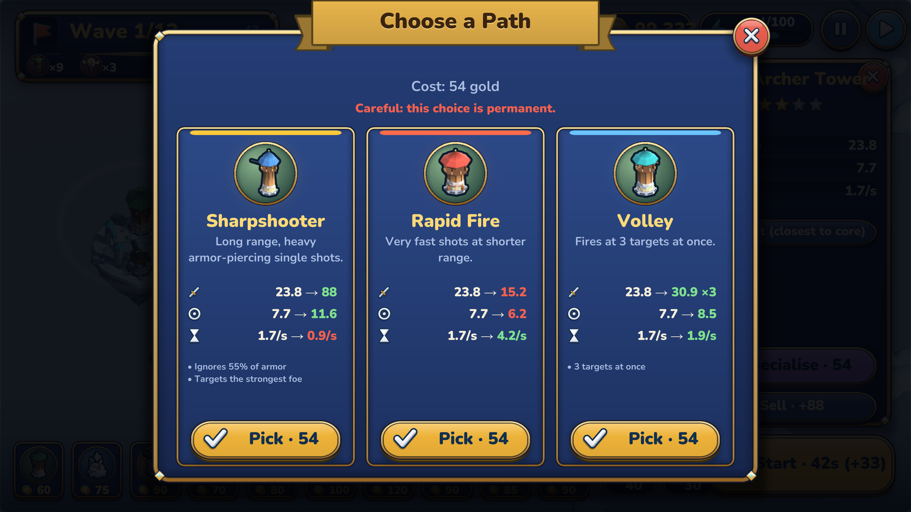<br><sub>Level 4: three paths with before and after numbers</sub></td>
  </tr>
  <tr>
    <td align="center">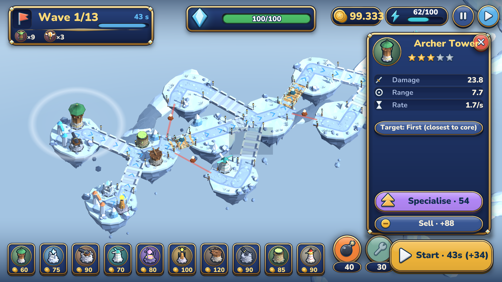<br><sub>Select a tower to see how far it reaches</sub></td>
    <td align="center">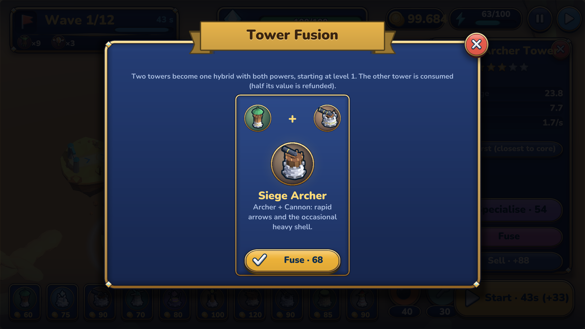<br><sub>Fuse two level-3 towers into a hybrid</sub></td>
  </tr>
  <tr>
    <td align="center">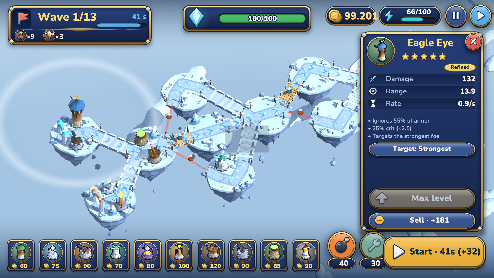<br><sub>A refined level-5 tower</sub></td>
    <td align="center">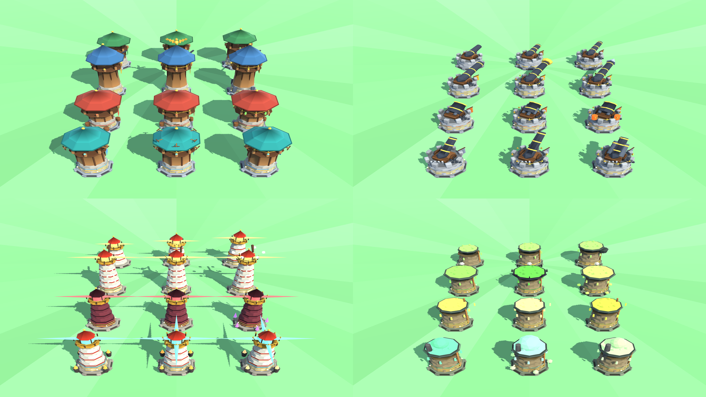<br><sub>Every stage and path has its own Blender-made model</sub></td>
  </tr>
  <tr>
    <td align="center">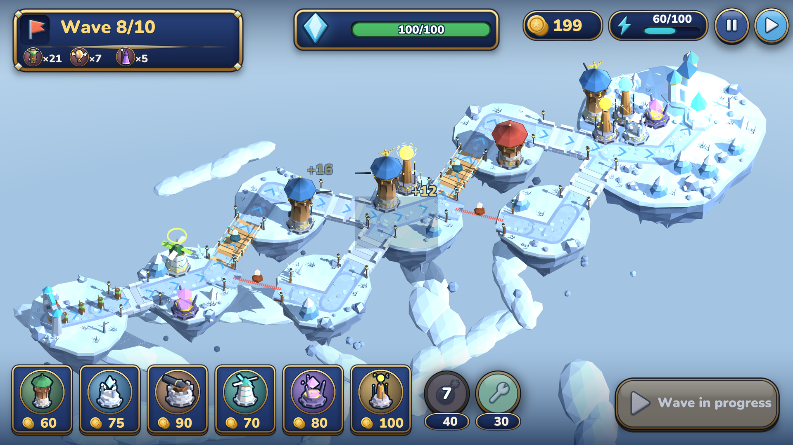<br><sub>Glacier Isles: blizzards slow your towers</sub></td>
    <td align="center">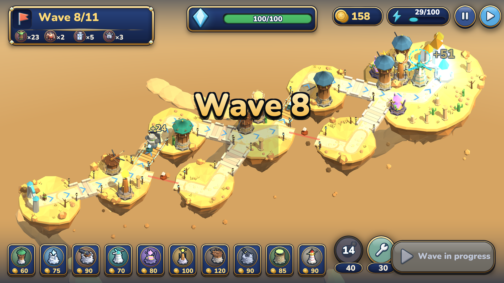<br><sub>Sunken Ruins: droughts and armored foes</sub></td>
  </tr>
  <tr>
    <td align="center">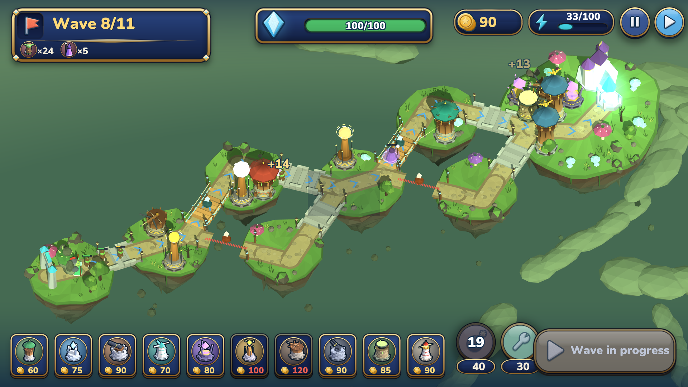<br><sub>Mushroom Bog: spore blooms heal the enemy</sub></td>
    <td align="center">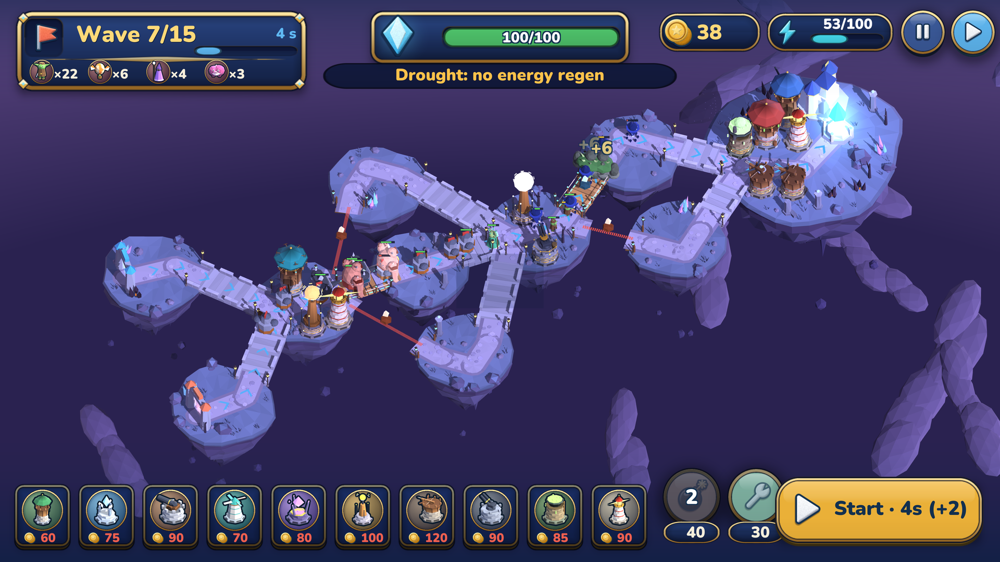<br><sub>Storm Citadel: the final stand</sub></td>
  </tr>
  <tr>
    <td align="center">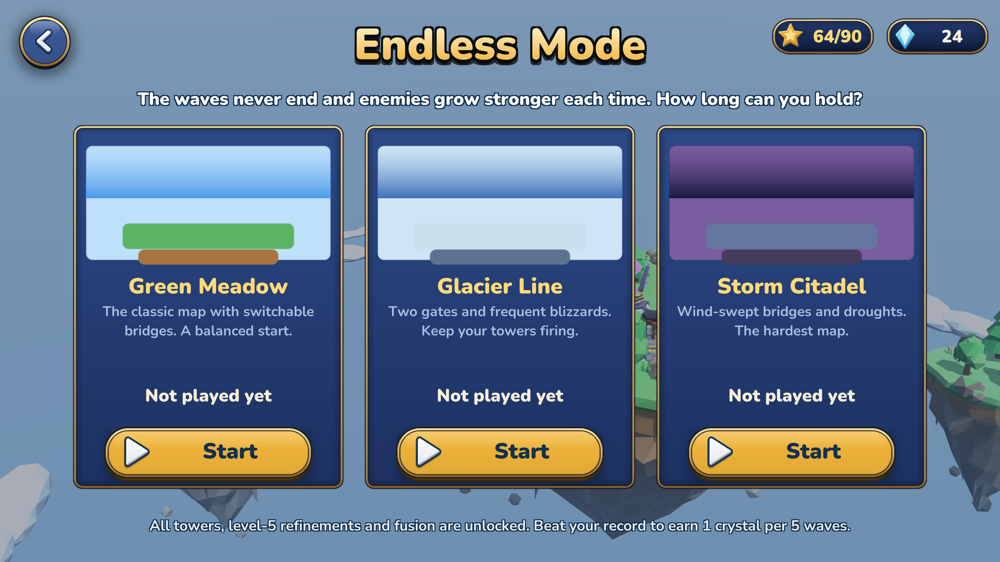<br><sub>Endless mode: three maps</sub></td>
    <td align="center">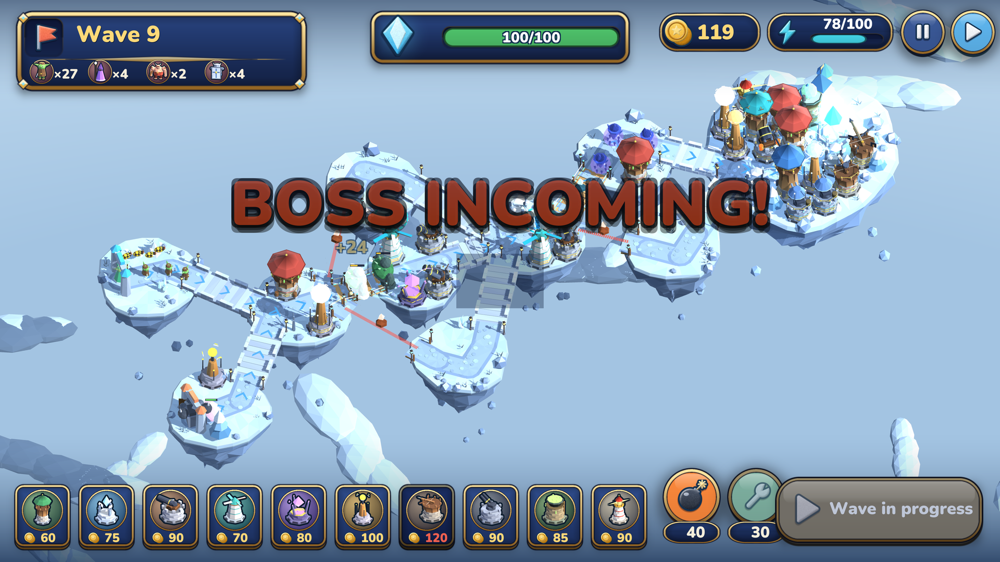<br><sub>Hold out against ever-bigger waves</sub></td>
  </tr>
  <tr>
    <td align="center">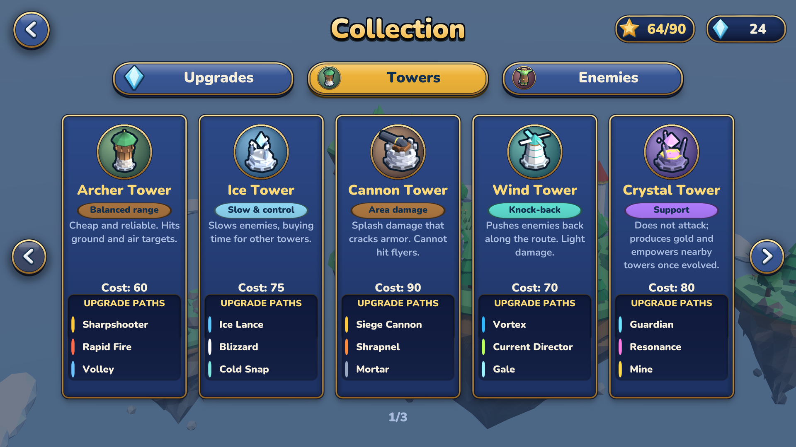<br><sub>The tower collection, with every upgrade path</sub></td>
    <td align="center">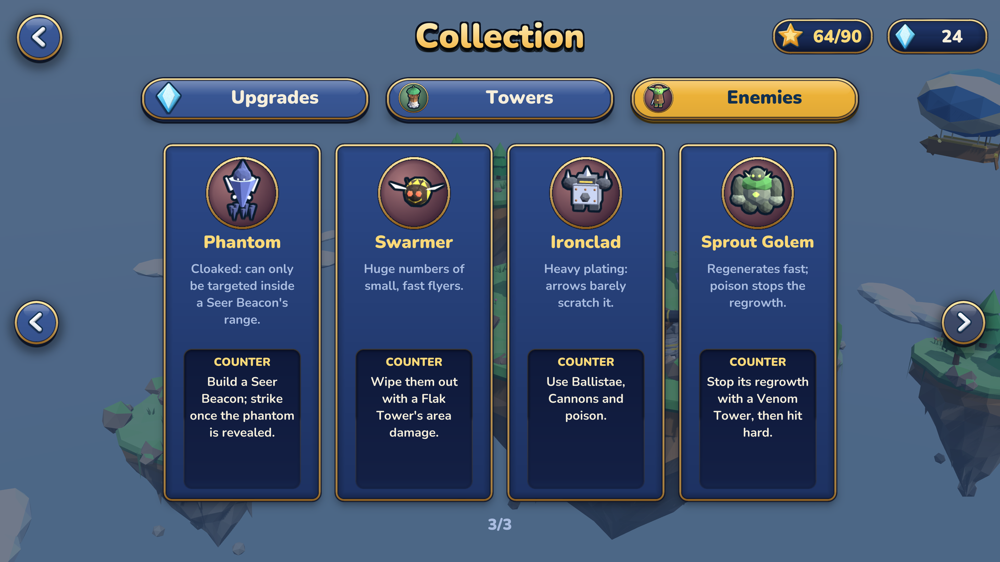<br><sub>New enemies come with a hint on how to counter them</sub></td>
  </tr>
  <tr>
    <td align="center">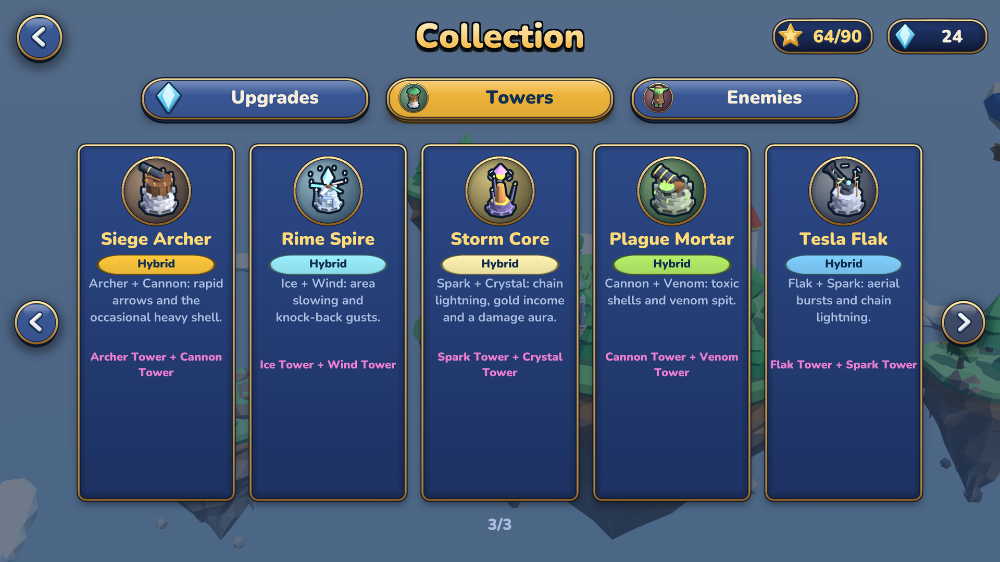<br><sub>Five hybrid towers</sub></td>
    <td align="center">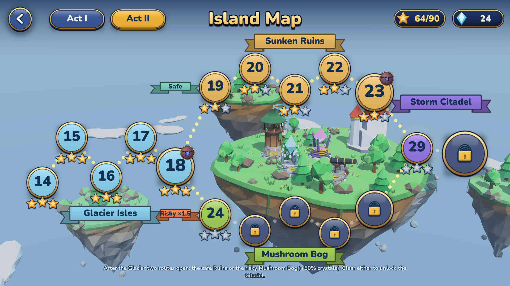<br><sub>The two-act island map</sub></td>
  </tr>
</table>

## How it's built

Skybound Realms was designed from a written game design document and built in **Unity 6.3 LTS** (built-in render pipeline) with **C#**. About **11,500 lines of game code**, plus about **1,300 lines of Python** that drive Blender to model the towers.

### Architecture

```
Data  ──►  Sim  ──►  Game (3D views)  ──►  UI
 defs      rules      meshes, camera,       runtime uGUI,
 levels    graph      effects               screens, popups
```

* **Simulation (`Sim`)**: a pure C# model of the battle with no Unity objects in it. It advances in fixed steps, which makes it deterministic and testable.
* **Data (`Data`)**: towers, upgrade paths, enemies and levels are data. A tower stage is its base stats plus a chain of small **stat modifiers** (tier, path, refinement), so 90 upgrade choices cost a few lines each. Levels come from a **ladder generator** and compact wave scripts such as `g8x0.8;z3x2.5+4;$25`.
* **Free placement** is rule-based: an island's grass outline is shared geometry, so the simulation and the 3D model builder agree on where grass ends.
* **Combat** supports multi-target volleys, criticals, poison over time, marks, cloaking and reveal, area bursts, chain lightning, second attack channels for hybrids and per-tower targeting priority.
* **Views and UI**: thin MonoBehaviours mirror the simulation; every screen is built from code from a single component in a single scene.

### Models made in Blender

Tower models are generated by a **Blender Python pipeline** (`bmesh`): bevelled primitives, flat shading, per-face palette colours and a **baked ambient-occlusion term** per vertex with a BVH ray cast. One script builds **135 meshes** (10 towers x 12 stages, 5 hybrids x 3), exports them as compact base64 JSON and the game loads them at runtime. Every level, path and refinement has a visibly different silhouette.

### Procedural art for everything else

* **Islands, enemies, bridges, trees** are low-poly meshes assembled in code with vertex colours.
* **Shader**: a custom Unity surface shader with wrapped diffuse, tinted shadows, rim light and a depth tint.
* **UI sprites** are painted at startup from **signed distance fields**; **icons** are rendered from the real 3D models.
* **Audio** is synthesised at runtime. Music and effects need no audio files.

### Testing and balance

* **EditMode tests** cover the graph, placement rules, upgrades, paths, fusion, poison, cloaking, flak, targeting and endless mode.
* A **bot player** plays every level headlessly and is used to tune difficulty.
* **PlayMode tests** boot the real game, drive the screens and capture the images on this page at 2x resolution, downsampled for crisp text.

### Tech summary

| | |
|---|---|
| Engine | Unity 6.3 LTS, built-in render pipeline |
| Language | C# (game), Python (Blender tools) |
| Platforms | Android, iOS (landscape) |
| Models | Blender (bmesh) towers, procedural everything else |
| UI | Runtime uGUI with SDF-painted sprites |
| Audio | Runtime-synthesised |
| Tests | Unity Test Framework, simulated bot |

---

## Türkçe özet

**Skybound Realms**, yüzen adalar üzerinde geçen 3D izometrik bir kule savunma oyunu.

* **İstediğin çimene kur:** kuleyi seç, çimene dokun, menzil halkasını gör. Yol, köprü ve çekirdek yakını yasak.
* **Köprüleri çevirerek rotayı değiştir**, enerji harcar ve bekleme süresi vardır.
* **5 kule seviyesi:** 4. seviyede 3 yoldan birini, 5. seviyede o yolun 2 gelişiminden birini seç. Toplam 90 kalıcı seçim; her aşamanın kendi modeli var, menzil halkaları geliştikçe büyür.
* **Melez kuleler:** 3. seviyedeki iki kuleyi birleştir (Okçu + Topçu = Kuşatma Okçusu gibi 5 tarif).
* **10 kule:** Okçu, Buz, Top, Rüzgâr, Kristal, Şimşek, Zehir, Balista, Uçaksavar, Gözcü Feneri. **14 düşman**, bazıları belirli kulelere karşı: görünmez Hayalet (Gözcü), Arı Sürüsü (Uçaksavar), Demir Zırhlı (Balista/Top), Filiz Golemi (Zehir).
* **Hedef önceliği**, kademeli açılan yetenekler (ilk bölümde yok, küçük bir öğretici ile gelir).
* **30 bölüm, 9 biyom, 2 perde** ve tüm kuleler açılınca açılan **Sonsuz Mod**.

Teknik olarak Unity 6.3 LTS ve C#. Yaklaşık 11.500 satır oyun kodu; kuleler **Blender'da Python ile** modellendi (135 mesh, köşe başına AO), diğer her şey kodla üretilen low-poly meshler, arayüz sprite'ları SDF ile çiziliyor, müzik ve efektler anlık sentezleniyor. Savaş mantığı Unity'den bağımsız saf C# simülasyonu; botla tüm seviyeler dengelendi.

Durum: geliştirme aşamasında · Android / iOS (yatay)

---

<sub>© Skybound Realms. All rights reserved. This page only showcases the game; no source code or game assets are included or licensed for reuse.</sub>
