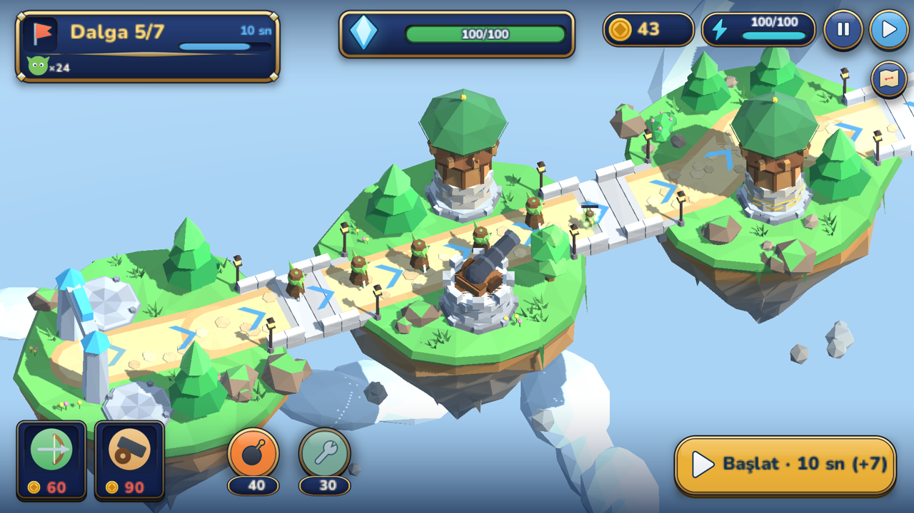
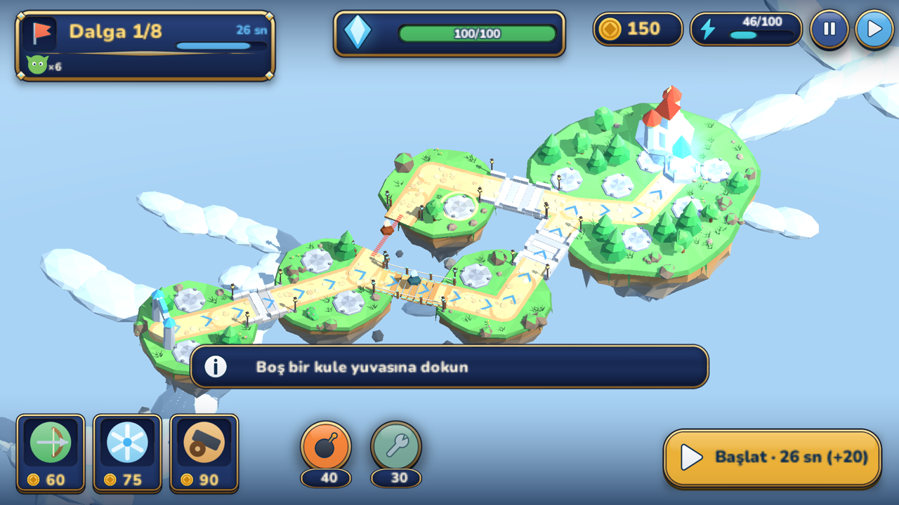
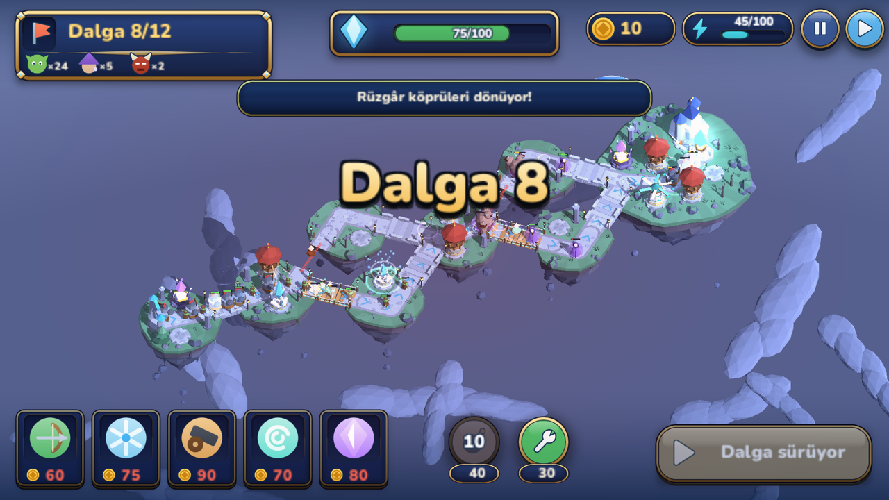
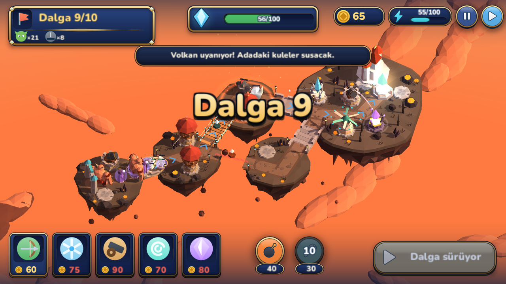
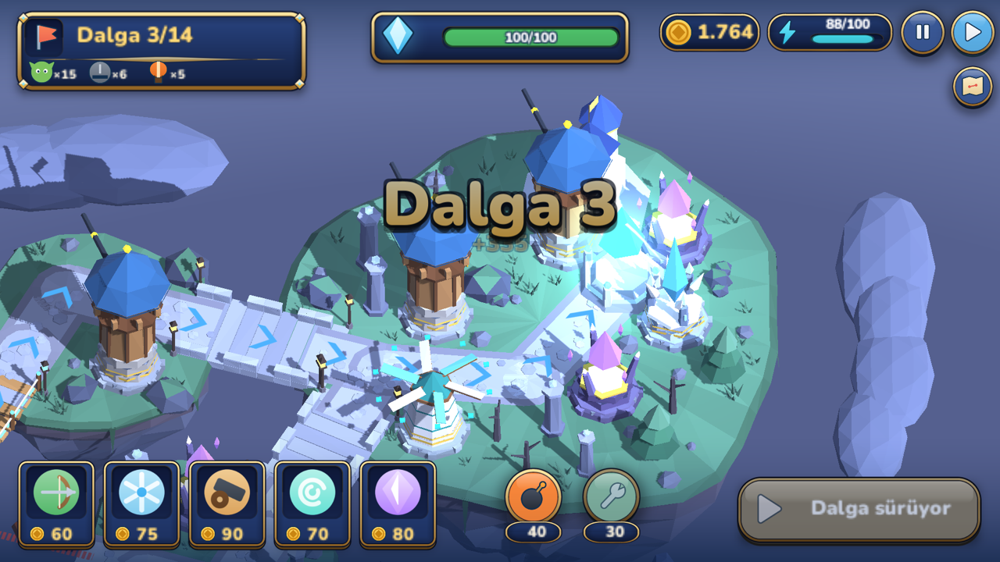
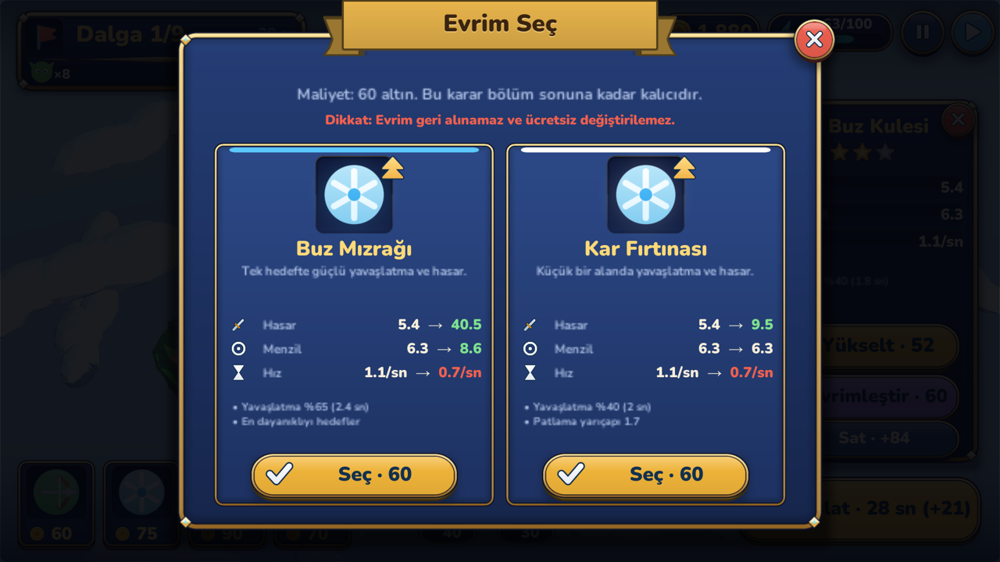
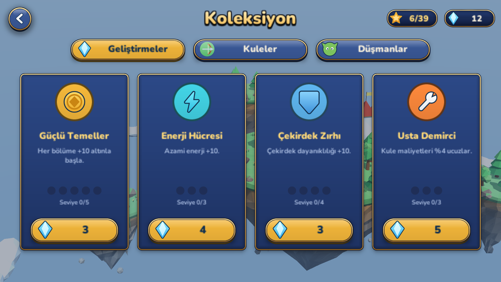
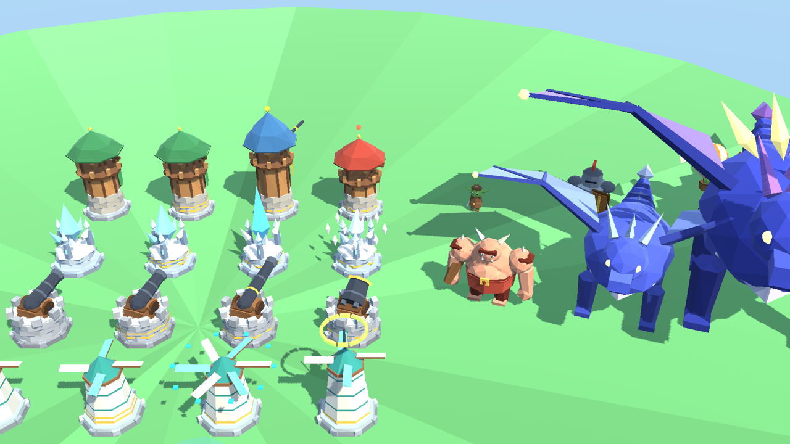

<h1 align="center">Skybound Realms</h1>
<p align="center"><b>A 3D isometric tower defense on floating islands</b> — rewire the bridges, redirect the enemy, protect the core crystal.</p>

<p align="center">
  
  
</p>

> **Status:** in development · Android / iOS (landscape) · built with Unity 6.3 LTS

## The game

Enemies march across a chain of floating islands toward your **core crystal**. You can't just wall them off with towers, because the real map is the **bridge network** between the islands.

* **Switch bridges to change the enemy's route.** Some bridges are switchable: flip one and the next wave takes a different path. Each switch costs energy and has a cooldown, so you can't do it constantly.
* **Plan with a route preview.** The current route is drawn in blue, the alternative in gold, and the game always keeps at least one valid route open to the core.
* **Commit mid-flight, not instantly.** Enemies finish the bridge they are standing on and re-route at the next node, so timing a switch matters.
* **Build, upgrade, evolve.** Place towers on stone pads, level them up, then pick one of two *permanent* evolutions.
* **Combine towers.** Neighbouring towers create synergies.
* **Use your abilities.** An airship bombardment and a core repair run on the same energy bar as the bridges.

### Towers

| Tower | Role | Evolutions |
|---|---|---|
| **Archer** | Fast single-target damage, hits air and ground | Sharpshooter (long range, heavy shots) · Rapid (very high fire rate) |
| **Frost** | Slows enemies | Ice Lance (strong single-target slow) · Blizzard (area slow) |
| **Cannon** | Slow, ground-only splash damage | Siege (huge single shell) · Shrapnel (wide blast) |
| **Wind** | Pushes enemies back along the road | Vortex (pulse that slows and shoves) · Current (aura that keeps dragging them back) |
| **Crystal** | No attack — generates gold | Guardian (shields the core) · Resonance (damage aura for nearby towers) |

### Synergies

Towers placed close to each other combine, and the game shows the link in-world:

* **Frosty Arrows** — Archer + Frost
* **Freezing Vortex** — Frost + Wind
* **Resonant Cannon** — Cannon + Crystal

Special **energy pads** on some islands boost any tower built on them.

### Enemies

Seven enemy types force you to change tactics: fast **Scouts**, slow and armoured **Armored** units, flying **Raiders** that ignore the cannon, **Mages**, heavy **Breakers**, and two bosses — a mini-boss and the **Storm Drake** that closes the campaign.

### Campaign

* **13 levels in 5 biomes** — Green Islands, Cloud Forest, Volcano Island, Crystal Peak and Storm Frontier, each with its own sky, fog, lighting and island dressing
* **A branching map:** after level 5 you choose a *safe* route or a *risky* one with better crystal rewards
* **3 stars per level** (39 in total) based on how much of the core you save
* **Permanent crystal upgrades** — extra starting gold, more energy, a tougher core, cheaper towers
* Per-level **gold, wave timers and early-start bonuses**
* **Turkish and English**, plus accessibility options (text size, high-contrast routes, screen-shake and vibration toggles)

## Screenshots

<table>
  <tr>
    <td align="center"><br><sub>The island map: safe and risky routes after level 5</sub></td>
    <td align="center"><br><sub>A switchable rope bridge and the route it opens</sub></td>
  </tr>
  <tr>
    <td align="center"><br><sub>Cloud Forest: a long winding chain of islands</sub></td>
    <td align="center"><br><sub>Volcano Island: the volcano wakes up mid-level</sub></td>
  </tr>
  <tr>
    <td align="center"><br><sub>Crystal Peak: all five towers, zoomed in on the core island</sub></td>
    <td align="center"><br><sub>Every tower evolves one of two ways — permanently</sub></td>
  </tr>
  <tr>
    <td align="center"><br><sub>Permanent upgrades bought with crystals</sub></td>
    <td align="center"><br><sub>Tower and enemy models, evolutions side by side</sub></td>
  </tr>
</table>

## How it's built

Skybound Realms was designed from a written game design document and built in **Unity 6.3 LTS** (built-in render pipeline) with **C#**. About **10,000 lines of code** and **no imported art or audio files** — everything you see and hear is generated.

### Architecture

The project is split into layers that only talk in one direction:

```
Data  ──►  Sim  ──►  Game (3D views)  ──►  UI
 defs      rules      meshes, camera,       runtime uGUI,
 levels    graph      effects               screens, popups
```

* **Simulation (`Sim`)** — a pure C# model of the battle with no Unity objects in it: the island graph, towers, enemies, projectiles, energy, abilities and synergies. It advances in fixed steps, which makes it deterministic and testable.
* **Island graph** — islands are nodes, roads and bridges are edges. Switchable bridges belong to *exclusive groups* (opening one closes its sibling), and a validity check guarantees a route to the core always exists. Enemies re-route at node boundaries.
* **Data (`Data`)** — all towers, evolutions, enemies and the 13 levels are data. Levels come from a **ladder generator** (entry → hub → branches → merge → core island) plus a compact **wave script** such as `g8x0.8;z3x2.5+4;$25` (8 scouts every 0.8 s, then 3 armoured every 2.5 s after 4 s, plus 25 bonus gold).
* **Views (`Game`)** — thin MonoBehaviours that mirror the simulation state into 3D objects, effects and camera movement.
* **UI (`UI`)** — every screen is built from code at runtime; the whole game runs from a **single component in a single scene**.
* **Services** — versioned JSON save, a Turkish/English string table and the audio engine.

### Procedural art, no art files

* **Models** — towers, enemies, islands, bridges, trees, rocks and crystals are low-poly meshes assembled in code by a small `MeshBuilder` (cylinders, cones, boxes, lofted shapes) with **vertex colours** instead of textures. Each island gets noise-driven grass colour, a rocky skirt with strata, stalactites, vines and per-biome props.
* **Shader** — a custom Unity surface shader gives the stylised look without making it plastic: soft wrapped diffuse, a gentle S-curve on the light falloff, tinted shadows, a rim light and a depth tint that fades the undersides of islands into the sky.
* **Lighting and sky** — each biome supplies sky gradient, fog, ambient and sun colours; the same values feed the shader.
* **UI sprites** — buttons, framed panels, icons and ribbons are painted at startup from **signed distance fields**, with light and shadow baked in, so one set of code scales cleanly to any resolution. The look is a night-navy and gold theme to match the sky setting.
* **Audio** — music and sound effects are synthesised at runtime.
* **Camera** — an orthographic isometric camera that frames each level automatically, with pinch-to-zoom, drag-to-pan and mouse wheel support on desktop.

### Testing and balance

* **EditMode tests** cover graph validity, slot placement, bridge rules, and tower and upgrade rules.
* A **bot player** (`SimBot`) plays every level headlessly. It is used to tune difficulty: it clears the early levels with two or three stars and finds the last levels genuinely hard.
* **PlayMode tests** boot the real game, walk through the screens and levels, and capture screenshots, which is how the images on this page were produced.
* Headless build scripts produce an Android build from the command line.

### Tech summary

| | |
|---|---|
| Engine | Unity 6.3 LTS, built-in render pipeline |
| Language | C# |
| Platforms | Android, iOS (landscape) |
| Rendering | Procedural low-poly meshes, vertex colours, custom surface shader |
| UI | Runtime uGUI with SDF-painted sprites |
| Audio | Runtime-synthesised |
| Save | Versioned JSON |
| Tests | Unity Test Framework (EditMode and PlayMode), simulated bot |

---

## Türkçe özet

**Skybound Realms**, yüzen adalar üzerinde geçen 3D izometrik bir kule savunma oyunu.

Düşmanlar adalar zincirini geçerek çekirdek kristale ilerler. Asıl harita, adalar arasındaki **köprü ağıdır**: değiştirilebilir bir köprüyü çevirirsiniz ve sonraki dalga farklı bir yoldan gelir. Her değiştirme enerji harcar ve bekleme süresi vardır; düşmanlar üzerinde bulundukları köprüyü bitirip bir sonraki düğümde yeni rotayı izler.

* **5 kule:** Okçu, Buz, Top, Rüzgâr ve Kristal. Her birinin kalıcı olarak seçilen 2 evrimi var
* **3 sinerji:** Donduran Oklar, Donduran Girdap, Rezonanslı Top
* **7 düşman türü** ve iki boss; kampanya Fırtına Ejderi ile biter
* **5 biyomda 13 seviye:** Yeşil Adalar, Bulut Ormanı, Volkan Adası, Kristal Zirve, Fırtına Sınırı
* 5. seviyeden sonra **güvenli** ve **riskli** rota seçimi
* Hava bombardımanı, çekirdek onarımı, kristallerle alınan kalıcı geliştirmeler, seviye başına 3 yıldız
* Türkçe ve İngilizce, erişilebilirlik seçenekleri

Teknik olarak: Unity 6.3 LTS ve C#. Yaklaşık 10.000 satır kod ve **hiç hazır sanat ya da ses dosyası yok**: modeller kodla üretilen low-poly meshler, arayüz sprite'ları SDF ile kodda çiziliyor, müzik ve efektler anlık sentezleniyor. Savaş mantığı Unity'den bağımsız saf C# simülasyonu; botla tüm seviyeler dengelendi.

Durum: geliştirme aşamasında · Android / iOS (yatay)

---

<sub>© Skybound Realms. All rights reserved. This page only showcases the game; no source code or game assets are included or licensed for reuse.</sub>
